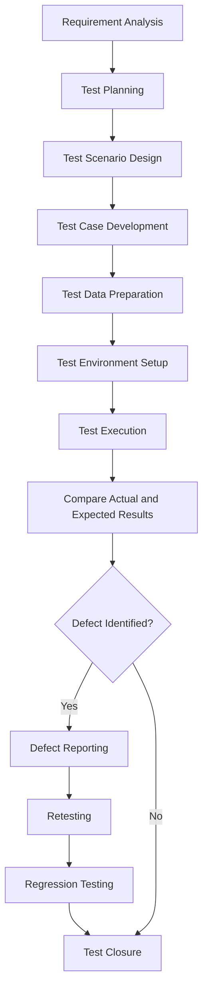
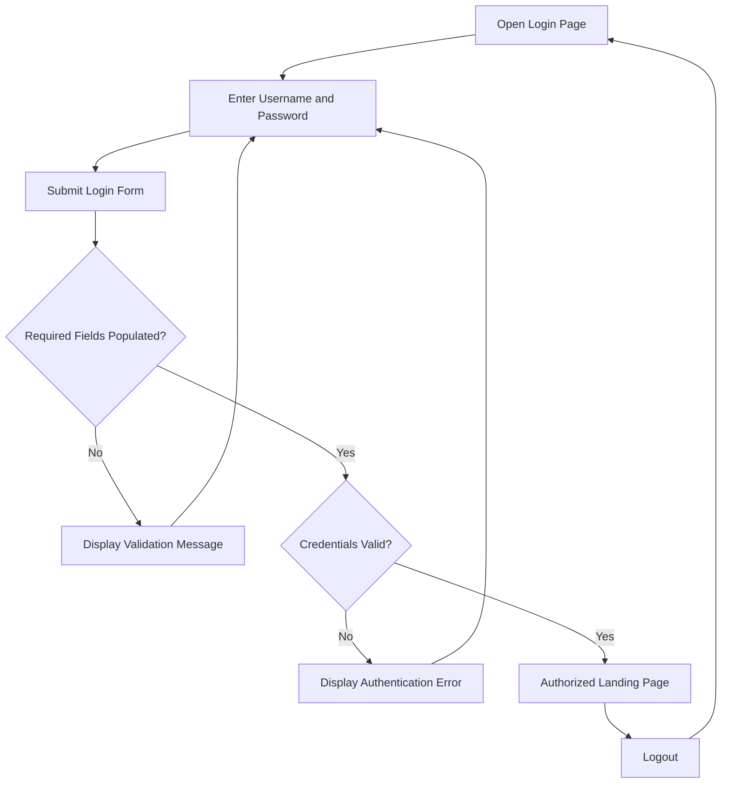
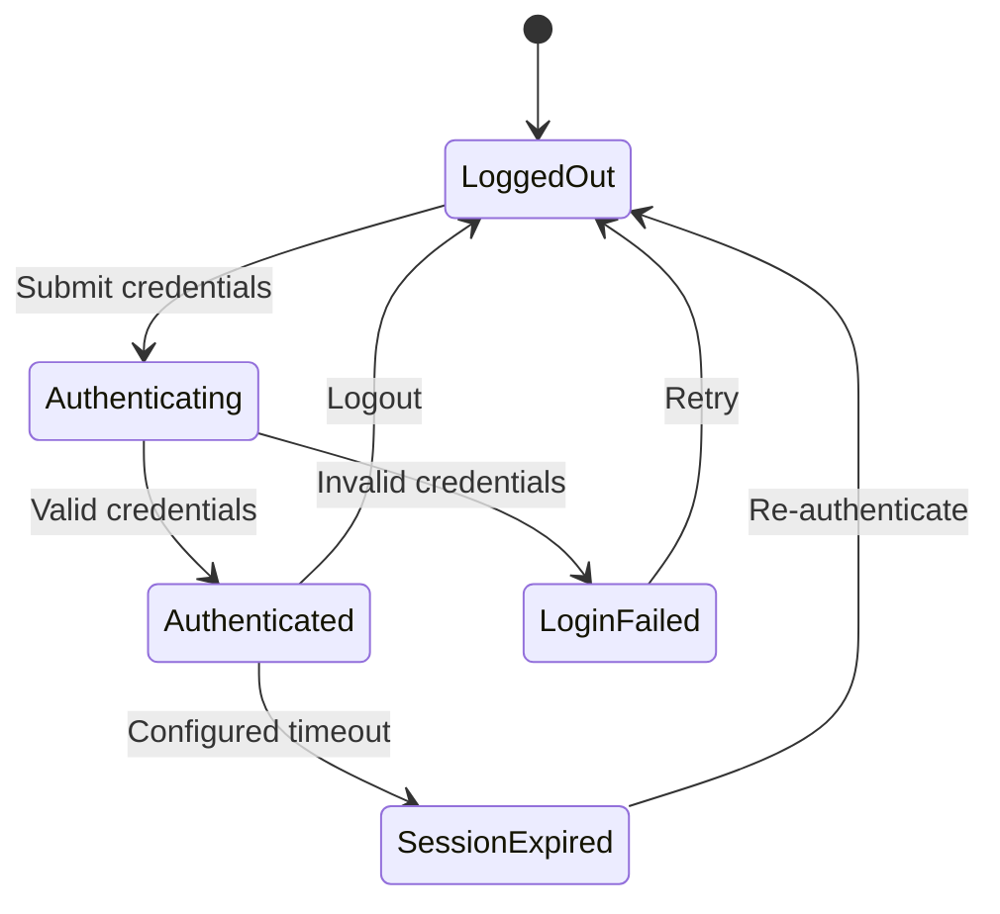
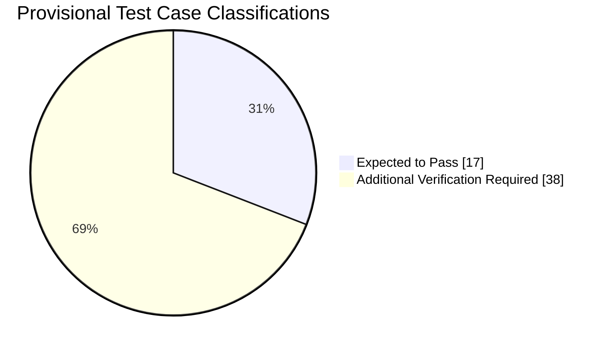
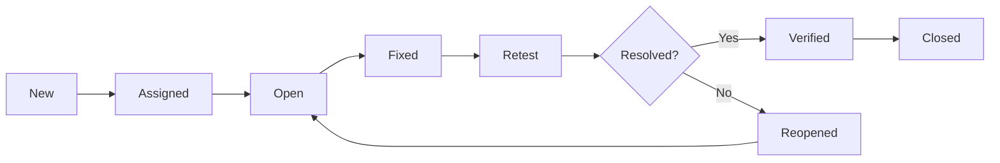

<div align="center">

# 🔐 Login Page — Manual Testing Project

### Software Quality Assurance | Manual Testing | QA Portfolio


**A structured manual software testing project focused on authentication, input validation, security, usability, compatibility, and professional QA documentation.**

</div>

---

## 📌 Project Overview

This project demonstrates a systematic approach to
manual software testing using a sample web application
login page.

It covers functional and non-functional test design,
positive and negative scenarios, input validation,
authentication, session management, security-related
checks, usability, accessibility, browser compatibility,
and basic performance observations.

The project follows the Software Testing Life Cycle
(STLC) and includes structured test scenarios, detailed
test cases, test data, traceability documentation,
provisional execution reporting, and defect management
templates.

---

## 🎯 Project Objectives

- Validate login and authentication functionality.
- Design positive and negative test scenarios.
- Verify mandatory field validation.
- Apply major black-box testing techniques.
- Validate username and password input boundaries.
- Evaluate authentication state transitions.
- Design session management and authorization checks.
- Evaluate usability and accessibility requirements.
- Plan cross-browser and responsive testing.
- Prepare structured test data.
- Maintain test case traceability.
- Document test results and reproducible defects.
- Plan retesting and regression testing.
- Demonstrate professional QA documentation skills.

---

## 📊 Project Highlights

<div align="center">

| Test Scenarios | Test Cases | Test Data Records |
|:---:|:---:|:---:|
| **52** | **55** | **45** |

| Testing Categories | Test Case Mapping | Documentation |
|:---:|:---:|:---:|
| **12** | **100%** | **Prepared** |

</div>

---

## 🧪 Scope of Testing

| Testing Category | Coverage | Test Cases |
|---|---|:---:|
| Functional Testing | Login, logout, credential validation and form submission | 9 |
| Mandatory Field Validation | Empty fields and whitespace inputs | 6 |
| Equivalence Partitioning | Valid and invalid input partitions | 4 |
| Boundary Value Analysis | Minimum and maximum input boundaries | 6 |
| Decision Table Testing | Credential combinations | 1 |
| State Transition Testing | Authentication states, lockout and session expiry | 5 |
| Error Guessing and Exploratory Testing | Unexpected inputs, refresh and network interruption | 6 |
| Security Testing | Password protection and authorization checks | 7 |
| Usability and Accessibility | Keyboard navigation, labels and readability | 4 |
| Compatibility Testing | Browser, mobile and responsive behavior | 3 |
| Basic Performance Testing | Login response and page-load observations | 2 |
| Retesting and Regression | Defect fixes and existing functionality | 2 |
| **Total** | | **55** |

---

## 🧠 Testing Techniques

| Testing Technique | Application |
|---|---|
| Positive Testing | Valid login credentials |
| Negative Testing | Invalid credentials and missing inputs |
| Equivalence Partitioning | Valid and invalid input groups |
| Boundary Value Analysis | Minimum and maximum username lengths |
| Decision Table Testing | Combinations of username and password conditions |
| State Transition Testing | Login, logout, failed authentication and session expiry |
| Error Guessing | Long inputs, special characters and repeated submissions |
| Exploratory Testing | Refresh behavior, network interruption and error messages |
| Security Testing | Authentication and sensitive information protection |
| Usability Testing | User interaction and readability |
| Compatibility Testing | Browser and device behavior |
| Retesting | Verification of applicable defect fixes |
| Regression Testing | Existing functionality after relevant changes |

The above represents test design coverage.
Actual execution coverage requires verification.

---

## 🔄 Software Testing Life Cycle



Final test closure requires verified execution results,
supporting evidence and applicable defect resolution.

---

## 🔐 Login Application Workflow



This diagram represents the expected login workflow.

---

## 📁 Project Files

| Document | Description |
|---|---|
| [Test Scenarios](./Test-Scenarios.md) | 52 structured functional and non-functional test scenarios |
| [Test Cases](./Test-Cases.md) | 55 detailed manual test cases with testing techniques |
| [Test Data](./Test-Data.md) | 45 test data records and traceability mapping |
| [Bug Report Template](./Bug-Report-Template.md) | Standard defect reporting format |
| [Test Execution Report](./Test-Execution-Report.md) | Provisional results, execution metrics and defect summary |

---

## 📂 Repository Structure

```text
Manual-Testing-Login-Page/
│
├── README.md
├── Test-Scenarios.md
├── Test-Cases.md
├── Test-Data.md
├── Bug-Report-Template.md
└── Test-Execution-Report.md
```

---

## 📋 Test Case Documentation

Each detailed test case includes:

- Test Case ID
- Test Scenario
- Testing Technique
- Priority
- Preconditions
- Test Data
- Test Steps
- Expected Result
- Actual Result or Verification Notes
- Execution Status

### Sample Test Case

| Field | Description |
|---|---|
| Test Case ID | TC001 |
| Test Scenario ID | TS001 |
| Test Data ID | TD001 |
| Test Scenario | Verify login using valid credentials |
| Testing Technique | Positive Testing |
| Priority | High |
| Precondition | An active test account exists |
| Username | ameesha_test |
| Password | ValidPass@123 |
| Expected Result | User successfully authenticates and navigates to the authorized landing page |
| Actual Result | Not verified |
| Provisional Classification | Expected to pass |

### Test Steps

1. Open the login page.
2. Enter a registered test username.
3. Enter the correct test password.
4. Click the Login button.
5. Observe the resulting page.
6. Compare the actual behavior with the expected result.

The credentials above are fictional examples.

---

## 📐 Boundary Value Analysis

### Assumed Username Length Requirements

- Minimum Length: 8 characters
- Maximum Length: 20 characters

| Boundary | Input Length | Expected Length Validation |
|---|---:|---|
| Minimum - 1 | 7 | Invalid |
| Minimum | 8 | Valid |
| Minimum + 1 | 9 | Valid |
| Maximum - 1 | 19 | Valid |
| Maximum | 20 | Valid |
| Maximum + 1 | 21 | Invalid |

These limits are hypothetical practice requirements.
Actual application requirements must be confirmed
before execution.

The 19-character input provides supplementary
boundary coverage.

---

## 🔀 Decision Table Testing

| Rule | Username | Password | Expected Action |
|---|---|---|---|
| R1 | Valid | Valid | Login successful |
| R2 | Valid | Invalid | Login rejected |
| R3 | Invalid | Valid | Login rejected |
| R4 | Invalid | Invalid | Login rejected |
| R5 | Empty | Valid | Username validation |
| R6 | Valid | Empty | Password validation |
| R7 | Empty | Empty | Required-field validation |

**Related Test Case:** TC026

---

## 🔁 State Transition Testing



Account lockout and session expiration are
application-dependent features.

---

## 🔗 Requirement Traceability Matrix

Test scenarios are mapped to corresponding test cases
and test data to improve coverage and maintainability.

| Scenario ID | Test Case ID | Test Data ID | Coverage |
|---|---|---|---|
| TS001 | TC001 | TD001 | Valid login |
| TS002 | TC002 | TD002 | Invalid username |
| TS003 | TC003 | TD003 | Incorrect password |
| TS005 | TC010 | TD005 | Empty credentials |
| TS010 | TC006 | TD010 | Password case sensitivity |
| TS013 | TC038 | TD023 | Password masking |
| TS015 | TC021 | TD014 | Minimum username length |
| TS016 | TC023 | TD016 | Maximum username length |
| TS020 | TC026 | TD001–TD007 | Decision table |
| TS023 | TC029 | TD021 | Account lockout |
| TS024 | TC030 | TD031 | Session expiry |
| TS025 | TC009 | TD030 | Logout and re-login |
| TS038 | TC049 | TD041 | Cross-browser testing |
| TS041 | TC052 | TD043 | Login response time |
| TS044 | TC055 | TD045 | Regression testing |

### Traceability Coverage

| Metric | Coverage |
|---|---:|
| Test Scenarios Mapped | 52/52 |
| Test Cases Mapped | 55/55 |
| Test Case Mapping Coverage | 100% |

The complete traceability matrix is available in
the Test Scenarios and Test Data documents.

Mapping coverage does not represent verified
execution or complete application requirement coverage.

---

## 📈 Test Execution Dashboard

### Overall Test Case Summary

| Classification | Count | Percentage |
|---|:---:|:---:|
| 🟢 Provisional Pass | 17 | 30.91% |
| 🟡 Additional Verification Required | 38 | 69.09% |
| Confirmed Passed | Not Established | — |
| Confirmed Failed | Not Established | — |
| Confirmed Blocked | Not Established | — |
| **Total Test Cases** | **55** | **100%** |

### Provisional Result Distribution



### Category-wise Result Summary

| Testing Category | Total | Provisional Pass | Additional Verification |
|---|:---:|:---:|:---:|
| Functional Testing | 9 | 5 | 4 |
| Mandatory Field Validation | 6 | 4 | 2 |
| Equivalence Partitioning | 4 | 4 | 0 |
| Boundary Value Analysis | 6 | 0 | 6 |
| Decision Table Testing | 1 | 1 | 0 |
| State Transition Testing | 5 | 2 | 3 |
| Error Guessing and Exploratory | 6 | 0 | 6 |
| Security Testing | 7 | 1 | 6 |
| Usability and Accessibility | 4 | 0 | 4 |
| Compatibility Testing | 3 | 0 | 3 |
| Basic Performance Testing | 2 | 0 | 2 |
| Retesting and Regression | 2 | 0 | 2 |
| **Total** | **55** | **17** | **38** |

### Test Scenario Summary

| Metric | Count |
|---|---:|
| Total Test Scenarios | 52 |
| Provisional Passed Scenarios | 14 |
| Scenarios Requiring Additional Verification | 38 |
| Provisional Classification Percentage | 26.92% |

> **Result Transparency:** The provisional classifications
> represent expected standard login behavior, not actual
> observed execution results. All 55 test cases require
> verified execution evidence before final Pass or Fail
> results can be established.

---

## 🐞 Defect Management

The project includes a structured defect reporting
template for documenting reproducible application issues.

### Defect Report Fields

- Defect ID
- Related Test Case ID
- Defect Title
- Module
- Test Environment
- Preconditions
- Steps to Reproduce
- Expected Result
- Actual Result
- Severity
- Priority
- Screenshot or Evidence
- Reported By
- Defect Status

### Defect Life Cycle



### Severity Classification

| Severity | Description |
|---|---|
| Critical | Application or essential authentication functionality becomes unusable |
| High | Major functionality or security behavior is affected |
| Medium | Partial functionality or validation is affected |
| Low | Minor UI or cosmetic issue |

### Priority Classification

| Priority | Description |
|---|---|
| P1 - High | Requires immediate resolution |
| P2 - Medium | Requires resolution within a planned cycle |
| P3 - Low | Can be resolved in a future update |

### Current Defect Status

Confirmed defect counts have not been established.

Actual defects must be reproduced and documented
with supporting evidence.

---

## 🔒 Security Testing Coverage

The security test design includes:

- Password masking
- Password visibility controls
- Authentication validation
- SQL injection input handling
- Script-like input handling
- Password exposure in URLs
- Protected page access
- Session expiration
- Account lockout
- Sensitive information disclosure

Security testing must be performed only in an
owned or explicitly authorized test environment.

These manual checks do not replace a professional
security assessment.

---

## 🌐 Compatibility Testing Coverage

### Planned Browser Coverage

| Browser | Planned Testing | Verification Status |
|---|---|---|
| Google Chrome | Login, validation and UI | Pending |
| Mozilla Firefox | Login, validation and UI | Pending |
| Microsoft Edge | Login, validation and UI | Pending |

### Responsive Testing Coverage

| Device Category | Example Viewport |
|---|---:|
| Small Mobile | 320 px |
| Mobile | 375 px |
| Tablet | 768 px |
| Desktop | 1024 px |
| Large Desktop | 1920 px |

Browser versions, device details and actual results
must be recorded during execution.

---

## 💻 Test Environment

| Parameter | Details |
|---|---|
| Application | Sample Web Application Login Page |
| Application Type | Web Application |
| Application URL | Not Recorded |
| Testing Method | Manual Testing |
| Testing Approach | Black-box Testing |
| Test Level | System Testing |
| Operating System | Not Recorded |
| Browser Version | Not Recorded |
| Build Version | Not Recorded |
| Execution Date | Not Recorded |
| Test Data | Fictional credentials and sample inputs |
| Documentation | Markdown |
| Version Control | Git and GitHub |

---

## 🛠️ Tools and Technologies

<div align="center">


</div>

| Tool | Purpose |
|---|---|
| Web Browser | Planned manual application testing |
| Browser Developer Tools | Planned network, UI and responsive inspection |
| Markdown | Structured test documentation |
| Git | Version control |
| GitHub | Repository management and QA portfolio |

---

## 🚀 How to Explore This Project

1. Review the Test Scenarios document.
2. Explore the 55 detailed manual test cases.
3. Review the 45 test data records.
4. Understand the applied testing techniques.
5. Review the requirement traceability matrix.
6. Configure an authorized login test environment.
7. Execute applicable test cases.
8. Compare actual and expected results.
9. Capture supporting execution evidence.
10. Report reproducible defects.
11. Perform applicable retesting and regression testing.
12. Update the test execution report.

### Sample Test Credentials

| Credential | Sample Value |
|---|---|
| Valid Username | ameesha_test |
| Valid Password | ValidPass@123 |
| Invalid Username | invalid_user_999 |
| Invalid Password | WrongPass@123 |

These credentials are illustrative and are not
confirmed accounts for a live application.

---

## 🎓 Skills Demonstrated

- Software Development Life Cycle (SDLC)
- Software Testing Life Cycle (STLC)
- Manual Software Testing
- Black-box Testing
- Requirement Analysis
- Test Scenario Design
- Test Case Development
- Test Data Preparation
- Functional Testing
- Negative Testing
- Equivalence Partitioning
- Boundary Value Analysis
- Decision Table Testing
- State Transition Testing
- Error Guessing
- Exploratory Testing
- Security Test Design
- Usability and Accessibility Test Design
- Compatibility Test Design
- Requirement Traceability
- Defect Life Cycle
- Severity and Priority Classification
- Test Execution Reporting
- Retesting and Regression Test Design
- Git and GitHub Documentation

---

## 📌 Project Deliverables

| Deliverable | Status |
|---|---|
| Test Scenario Documentation | Completed |
| Detailed Test Case Documentation | Completed |
| Test Data Documentation | Completed |
| Test Case Traceability Matrix | Completed |
| Boundary Value Analysis | Designed |
| Decision Table | Prepared |
| State Transition Diagram | Prepared |
| Test Execution Report | Provisional |
| Execution Dashboard | Prepared |
| Bug Report Template | Prepared |
| Actual Execution Evidence | Pending |
| Confirmed Defect Reports | Pending |
| Final Test Closure | Pending |

---

## ✅ Project Completion Checklist

- [x] Requirement identification
- [x] Test scenario preparation
- [x] Detailed test case development
- [x] Test data preparation
- [x] Functional and negative test design
- [x] Equivalence Partitioning
- [x] Boundary Value Analysis
- [x] Decision Table Testing design
- [x] State Transition Testing design
- [x] Security test design
- [x] Usability and accessibility test design
- [x] Compatibility test design
- [x] Requirement traceability
- [x] Defect reporting template
- [x] Provisional execution report
- [x] Execution dashboard
- [ ] Application requirements confirmation
- [ ] Actual test execution verification
- [ ] Supporting evidence collection
- [ ] Confirmed defect reporting
- [ ] Applicable retesting and regression
- [ ] Final test closure

---

## 🔮 Future Enhancements

- Execute the test suite against a dedicated login application.
- Capture screenshots and supporting evidence.
- Prepare an Excel test execution dashboard.
- Expand browser and mobile testing coverage.
- Add API testing using Postman.
- Add database validation using SQL.
- Automate login workflows using Selenium with Java.
- Implement Selenium automation using Python.
- Implement Playwright automation using C#.
- Integrate automated tests with GitHub Actions.
- Generate automated test execution reports.

---

## ⚠️ Important Notes

- This repository is a QA learning and portfolio project.
- All sample credentials are fictional.
- Username length boundaries are hypothetical requirements.
- Provisional classifications are not confirmed test results.
- Actual execution results must be supported by evidence.
- Security testing requires explicit authorization.
- Unsupported application features should be marked Not Applicable.
- Final defect counts and pass rates require verified execution.

---

## 📝 Conclusion

The Login Page Manual Testing project demonstrates
a systematic approach to software quality assurance
through structured test design and documentation.

The project includes 52 test scenarios, 55 detailed
manual test cases and 45 test data records covering
major functional and non-functional testing areas.

It demonstrates knowledge of black-box testing
techniques, requirement traceability, authentication
workflows, defect management and test execution reporting.

The documentation is prepared, while verified
application execution and final test closure remain pending.

---

## 👩‍💻 Author

<div align="center">

### Gade Ameesha

**Software Developer | QA Engineer**

*Passionate about Software Development, Software Testing,
Quality Assurance and Continuous Learning.*

[](https://github.com/GadeAmeesha)

[](https://www.linkedin.com/in/gade-ameesha/)

---

⭐ **If you find this project useful, consider starring the repository.**

**Test • Identify • Improve • Deliver Quality**

*Testing is not just about finding defects.
It is about building confidence in software.*

</div>
