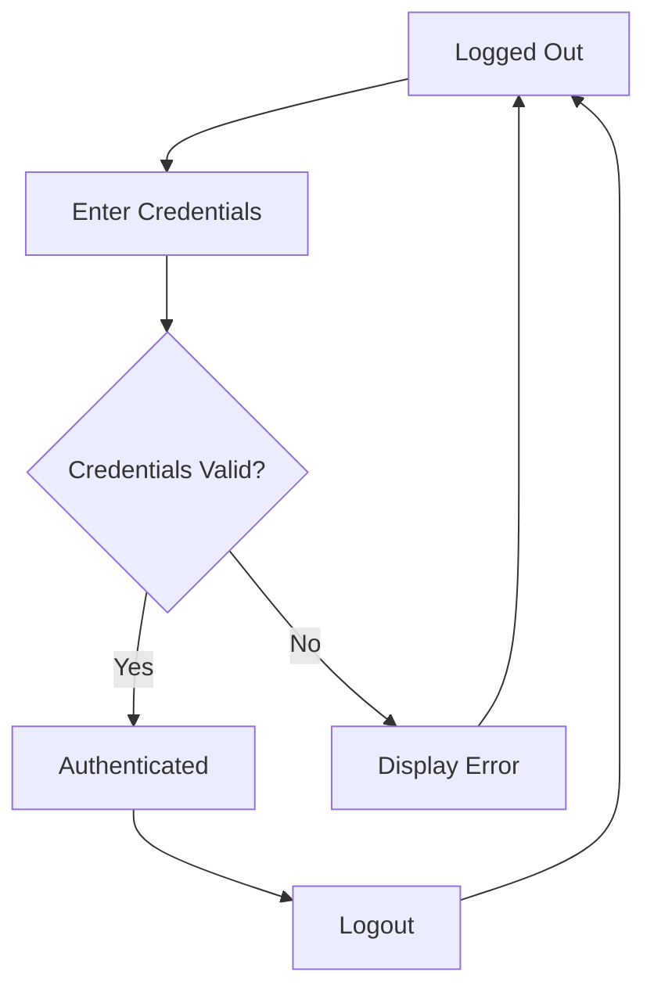
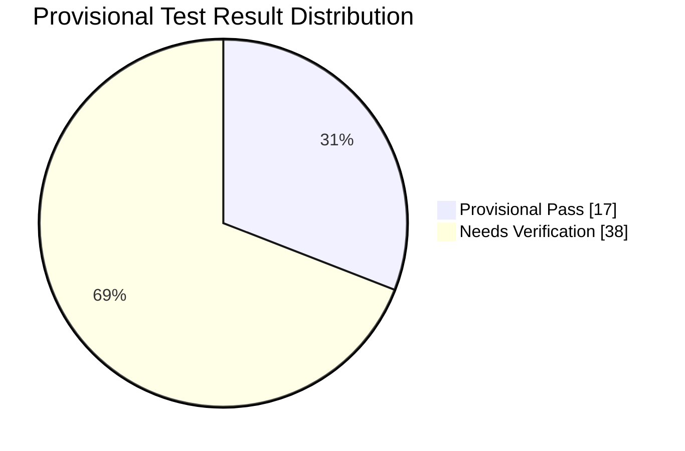

# Login Page Manual Testing — Test Execution Results

## 1. Project Information

- **Project Name:** Login Page Manual Testing
- **Application:** Sample Web Application
- **Testing Type:** Manual Testing
- **Test Level:** System Testing
- **Test Approach:** Black-box Testing
- **Total Test Cases:** 55
- **Result Status:** Provisional — Pending Verification
- **Author:** Gade Ameesha

---

## 2. Functional Testing

| Test Case ID | Test Scenario | Reconstructed Actual Result | Status |
|---|---|---|---|
| TC001 | Login with valid credentials | Valid credentials allow access to the authorized landing page. | Provisional Pass |
| TC002 | Login with invalid username | Authentication is rejected with an appropriate error message. | Provisional Pass |
| TC003 | Login with invalid password | Incorrect password is rejected. | Provisional Pass |
| TC004 | Both credentials invalid | Authentication is denied without exposing sensitive information. | Provisional Pass |
| TC005 | Username case sensitivity | Username case-sensitivity rules require confirmation. | Needs Verification |
| TC006 | Password case sensitivity | Correct password is accepted and case-modified password is rejected. | Provisional Pass |
| TC007 | Login button behavior | Login form submission and duplicate-action handling require confirmation. | Needs Verification |
| TC008 | Login using Enter key | Keyboard submission behavior requires confirmation. | Needs Verification |
| TC009 | Logout and re-login | Logout, protected-page access and subsequent login require verification. | Needs Verification |

---

## 3. Mandatory Field Validation

| Test Case ID | Test Scenario | Reconstructed Actual Result | Status |
|---|---|---|---|
| TC010 | Both fields empty | Login is prevented and mandatory-field validation is displayed. | Provisional Pass |
| TC011 | Empty username | Username required validation is displayed. | Provisional Pass |
| TC012 | Empty password | Password required validation is displayed. | Provisional Pass |
| TC013 | Spaces only in username | Whitespace-only username validation requires confirmation. | Needs Verification |
| TC014 | Spaces only in password | An incorrect whitespace-only password is rejected. | Provisional Pass |
| TC015 | Leading and trailing spaces | Username trimming and password whitespace handling require verification. | Needs Verification |

---

## 4. Equivalence Partitioning

| Test Case ID | Test Scenario | Reconstructed Actual Result | Status |
|---|---|---|---|
| TC016 | Valid username partition | Registered username with the correct password allows login. | Provisional Pass |
| TC017 | Invalid username partition | Invalid or unregistered username is rejected. | Provisional Pass |
| TC018 | Valid password partition | Correct password allows successful authentication. | Provisional Pass |
| TC019 | Invalid password partition | Incorrect password is rejected. | Provisional Pass |

---

## 5. Boundary Value Analysis

The username length range of 8–20 characters is a
practice assumption. Actual application requirements
must be confirmed before evaluating these results.

| Test Case ID | Test Scenario | Test Data | Actual Result / Verification Required | Status |
|---|---|---|---|---|
| TC020 | Below minimum length | 7 characters | Minimum-length validation requires confirmation. | Needs Verification |
| TC021 | Minimum length | 8 characters | Acceptance at the minimum boundary requires confirmation. | Needs Verification |
| TC022 | Above minimum length | 9 characters | Input acceptance above the minimum requires confirmation. | Needs Verification |
| TC023 | Maximum length | 20 characters | Acceptance at the maximum boundary requires confirmation. | Needs Verification |
| TC024 | Above maximum length | 21 characters | Maximum-length validation and truncation behavior require confirmation. | Needs Verification |
| TC025 | Empty and one-character username | 0 and 1 character | Empty-field rejection is expected; single-character handling requires confirmation. | Needs Verification |

---

## 6. Decision Table Testing

### TC026 — Credential Combination Validation

| Rule | Username | Password | Expected Action | Reconstructed Result |
|---|---|---|---|---|
| R1 | Valid | Valid | Authenticate | Login successful |
| R2 | Valid | Invalid | Reject login | Authentication rejected |
| R3 | Invalid | Valid | Reject login | Authentication rejected |
| R4 | Invalid | Invalid | Reject login | Authentication rejected |
| R5 | Empty | Valid | Show validation | Username required |
| R6 | Valid | Empty | Show validation | Password required |
| R7 | Empty | Empty | Show validation | Required-field validation |

**Overall Status:** Provisional Pass

Individual rule execution must be verified against
the actual application.

---

## 7. State Transition Testing

| Test Case ID | Test Scenario | Reconstructed Actual Result | Status |
|---|---|---|---|
| TC027 | Successful login state transition | User moves from logged-out to authenticated state. | Provisional Pass |
| TC028 | Failed login state transition | User remains unauthenticated after invalid credentials. | Provisional Pass |
| TC029 | Account lockout after repeated failures | Account lockout support and configured threshold require confirmation. | Needs Verification |
| TC030 | Session expiry | Configured timeout and expired-session behavior require confirmation. | Needs Verification |
| TC031 | Browser Back after logout | Protected-page access through browser history requires verification. | Needs Verification |

### State Transition Flow

---

## 8. Error Guessing and Exploratory Testing

| Test Case ID | Test Scenario | Actual Result / Verification Required | Status |
|---|---|---|---|
| TC032 | Extremely long input | Input limits, responsiveness and error handling require verification. | Needs Verification |
| TC033 | Special characters in username | Permitted and unsupported character rules require confirmation. | Needs Verification |
| TC034 | Rapid repeated login clicks | Duplicate submission handling requires verification. | Needs Verification |
| TC035 | Refresh during login | Authentication state after refresh requires verification. | Needs Verification |
| TC036 | Network interruption during login | Network failure messages and recovery behavior require verification. | Needs Verification |
| TC037 | Error message consistency | Error-message consistency and information disclosure require confirmation. | Needs Verification |

---

## 9. Security Testing

Security checks must be performed only in an owned
or explicitly authorized test environment.

| Test Case ID | Test Scenario | Actual Result / Verification Required | Status |
|---|---|---|---|
| TC038 | Password masking | Password characters are expected to remain masked by default. | Provisional Pass |
| TC039 | Show/Hide password | Availability and behavior of the visibility control require confirmation. | Needs Verification |
| TC040 | SQL injection input handling | Authentication and database error handling require authorized verification. | Needs Verification |
| TC041 | Script injection input handling | Safe input rendering requires authorized verification. | Needs Verification |
| TC042 | Password exposure in URL | Browser URL and request details require inspection. | Needs Verification |
| TC043 | Protected page access without login | Direct URL access and authorization controls require verification. | Needs Verification |
| TC044 | Sensitive information in error messages | Error messages require inspection for sensitive information disclosure. | Needs Verification |

**Security Assessment Status:** Pending verification.

These checks do not establish that the application
is free from security vulnerabilities.

---

## 10. Usability and Accessibility Testing

| Test Case ID | Test Scenario | Actual Result / Verification Required | Status |
|---|---|---|---|
| TC045 | Keyboard navigation | Tab order, keyboard operation and focus indicators require verification. | Needs Verification |
| TC046 | Field labels and error messages | Field labels and accessible validation messages require inspection. | Needs Verification |
| TC047 | Password copy/paste behavior | Clipboard and password-manager behavior require confirmation. | Needs Verification |
| TC048 | Login page layout and readability | Alignment, readability and validation-message placement require inspection. | Needs Verification |

---

## 11. Compatibility and Responsive Testing

| Test Case ID | Test Scenario | Test Environment | Actual Result / Verification Required | Status |
|---|---|---|---|---|
| TC049 | Cross-browser login | Chrome, Firefox, Edge | Browser-specific results are unavailable. | Needs Verification |
| TC050 | Responsive layout | 320px, 375px, 768px, 1024px | Layout and usability at each viewport require verification. | Needs Verification |
| TC051 | Mobile keyboard and input behavior | Mobile browser | Mobile keyboard and input behavior require verification. | Needs Verification |

---

## 12. Basic Performance Testing

| Test Case ID | Test Scenario | Actual Result / Verification Required | Status |
|---|---|---|---|
| TC052 | Login response time | Response-time measurements and acceptance criteria are unavailable. | Needs Verification |
| TC053 | Login page load time | Page-load measurements and performance targets require confirmation. | Needs Verification |

Actual response times must be measured before
performance results can be classified as Pass or Fail.

---

## 13. Retesting and Regression Testing

| Test Case ID | Test Scenario | Actual Result / Verification Required | Status |
|---|---|---|---|
| TC054 | Retest a fixed login defect | No documented defect fix is available for retesting. | Needs Verification |
| TC055 | Regression test existing login behavior | A documented application change and regression baseline are required. | Needs Verification |

---

## 14. Module-wise Test Execution Summary

| Testing Category | Total | Provisional Pass | Needs Verification |
|---|---:|---:|---:|
| Functional Testing | 9 | 5 | 4 |
| Mandatory Field Validation | 6 | 4 | 2 |
| Equivalence Partitioning | 4 | 4 | 0 |
| Boundary Value Analysis | 6 | 0 | 6 |
| Decision Table Testing | 1 | 1 | 0 |
| State Transition Testing | 5 | 2 | 3 |
| Error Guessing and Exploratory Testing | 6 | 0 | 6 |
| Security Testing | 7 | 1 | 6 |
| Usability and Accessibility Testing | 4 | 0 | 4 |
| Compatibility Testing | 3 | 0 | 3 |
| Basic Performance Testing | 2 | 0 | 2 |
| Retesting and Regression Testing | 2 | 0 | 2 |
| **Total** | **55** | **17** | **38** |

---

## 15. Test Execution Dashboard

| Metric | Result |
|---|---:|
| Total Test Cases | 55 |
| Provisional Passed | 17 |
| Needs Verification | 38 |
| Confirmed Passed | Not Established |
| Confirmed Failed | Not Established |
| Confirmed Blocked | Not Established |
| Confirmed Defects | Not Established |
| Provisional Pass Percentage | 30.91% |
| Verification Pending Percentage | 69.09% |

### Result Distribution

The provisional percentages are not verified
application quality or execution pass-rate metrics.

---

## 16. Testing Techniques Coverage

| Testing Technique | Test Case Coverage |
|---|---|
| Positive Testing | TC001, TC006, TC016, TC018 |
| Negative Testing | TC002–TC004, TC010–TC014 |
| Equivalence Partitioning | TC016–TC019 |
| Boundary Value Analysis | TC020–TC025 |
| Decision Table Testing | TC026 |
| State Transition Testing | TC027–TC031 |
| Error Guessing | TC013, TC015, TC032–TC034 |
| Exploratory Testing | TC035–TC037 |
| Security Testing | TC038–TC044 |
| Usability and Accessibility Testing | TC045–TC048 |
| Compatibility Testing | TC049–TC051 |
| Basic Performance Testing | TC052–TC053 |
| Retesting | TC054 |
| Regression Testing | TC055 |

This table represents test design coverage rather
than confirmed execution of every technique.

---

## 17. Defect Report

### Defect Reporting Status

Confirmed defects have not been established.

Potential issues must be reproduced against the
actual application before being reported as defects.

### Defect Report Format

| Field | Description |
|---|---|
| Defect ID | BUG-001 |
| Related Test Case ID | Relevant test case |
| Defect Title | Short description of the issue |
| Module | Login |
| Environment | Browser, OS and application version |
| Preconditions | Required test setup |
| Steps to Reproduce | Detailed reproduction steps |
| Expected Result | Expected application behavior |
| Actual Result | Observed application behavior |
| Severity | Critical / High / Medium / Low |
| Priority | High / Medium / Low |
| Evidence | Screenshot or logs |
| Status | New / Assigned / Fixed / Retest / Closed |

The above is a reporting template, not a confirmed defect.

---

## 18. Test Environment

| Parameter | Details |
|---|---|
| Application | Sample Web Application Login Page |
| Application URL | Not Recorded |
| Testing Approach | Black-box Testing |
| Test Level | System Testing |
| Operating System | Not Recorded |
| Browser | Not Recorded |
| Browser Version | Not Recorded |
| Test Data | Valid and invalid test credentials |
| Documentation | Markdown |
| Version Control | Git and GitHub |
| Execution Evidence | Not Available |

---

## 19. Project Deliverables

| Deliverable | Status |
|---|---|
| Test Case Documentation | Completed |
| Functional Test Cases | Completed |
| Negative Test Cases | Completed |
| Test Data Design | Completed |
| Boundary Value Test Design | Completed |
| Decision Table | Completed |
| State Transition Test Design | Completed |
| Security Test Design | Completed |
| Compatibility Test Design | Completed |
| Performance Test Design | Completed |
| Result Documentation | Provisional |
| Test Execution Verification | Pending |
| Defect Confirmation | Pending |
| Retesting | Pending applicable fixes |
| Regression Testing | Pending applicable changes |
| Final Test Closure | Pending |

---

## 20. Skills Demonstrated

- Manual Software Testing
- Black-box Testing
- Software Testing Life Cycle
- Test Case Design
- Test Data Preparation
- Functional Testing
- Positive and Negative Testing
- Equivalence Partitioning
- Boundary Value Analysis
- Decision Table Testing
- State Transition Testing
- Error Guessing
- Exploratory Testing
- Security Test Design
- Usability Test Design
- Compatibility Test Design
- Defect Reporting
- Severity and Priority Classification
- Test Execution Reporting
- Git and GitHub Documentation

---

## 21. Final Project Status

- **Total Test Cases:** 55
- **Test Case Design:** Completed
- **Provisional Passed:** 17
- **Needs Verification:** 38
- **Result Documentation:** Prepared
- **Confirmed Execution Results:** Not Established
- **Confirmed Defects:** Not Established
- **Final Test Closure:** Pending

---

## 22. Conclusion

The Login Page Manual Testing project demonstrates
a structured approach to validating authentication,
input validation, session management, security,
usability, compatibility and error handling.

A total of 55 detailed manual test cases were
designed using major black-box testing techniques.

Based on standard login behavior, 17 test cases
are provisionally classified as passed, while
38 require application-specific verification.

The provisional results are not a substitute
for actual execution evidence.

Final pass/fail results, performance measurements
and defect counts must be established through
verified application testing.

---

## Author

**Gade Ameesha**

Software Developer | QA Engineer

- GitHub: https://github.com/GadeAmeesha
- LinkedIn: https://www.linkedin.com/in/gade-ameesha/
