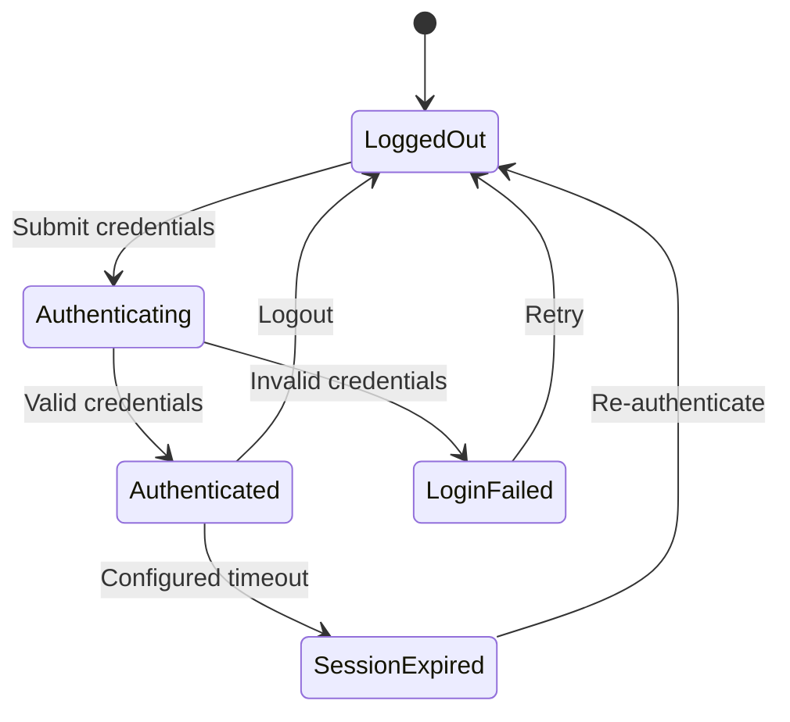
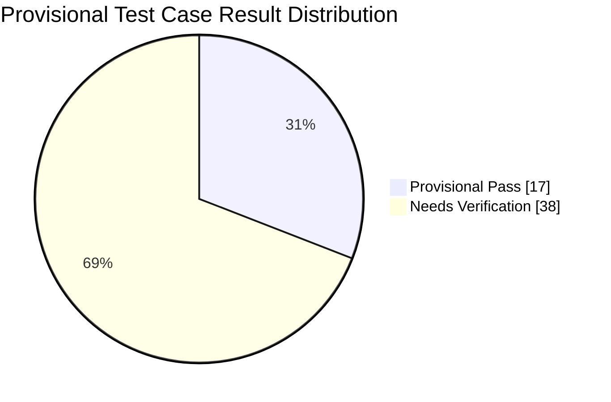
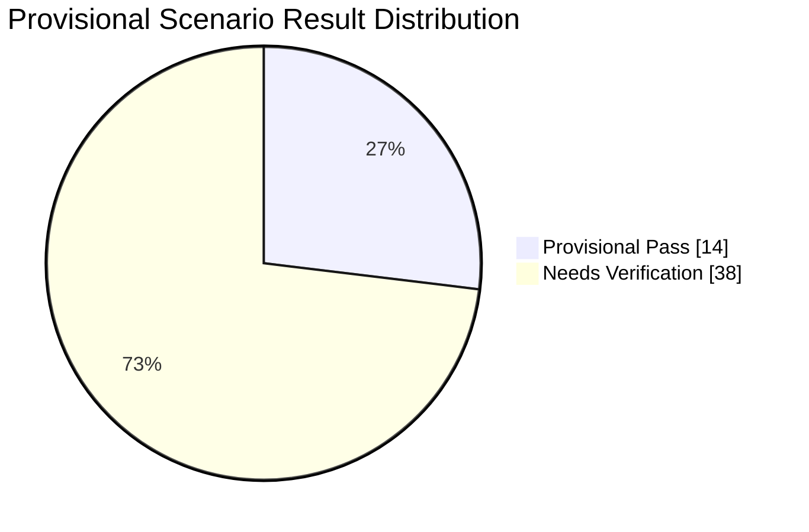
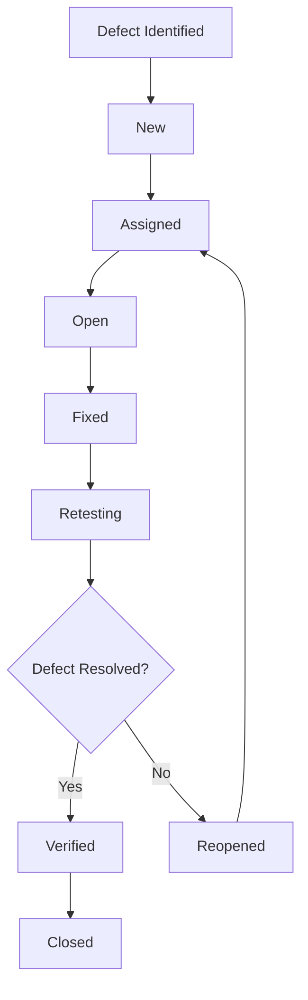

# Login Page Manual Testing — Test Execution Report

## 1. Project Information

| Parameter | Details |
|---|---|
| Project Name | Login Page Manual Testing |
| Project Type | QA Portfolio Project |
| Application | Sample Web Application Login Page |
| Testing Type | Manual Testing |
| Test Approach | Black-box Testing |
| Test Level | System Testing |
| Module | Login and Authentication |
| Tested By | Gade Ameesha |
| Test Environment | Not Recorded |
| Browser | Not Recorded |
| Operating System | Not Recorded |
| Execution Date | Not Recorded |
| Build Version | Not Recorded |
| Report Status | Provisional — Pending Verification |

---

## 2. Report Objective

The objective of this report is to document the
test execution status, expected application behavior,
provisional result classifications, defect reporting
status, testing coverage, risks and limitations.

The report covers 55 manual test cases designed
for validating login functionality using major
software testing techniques.

---

## 3. Project Coverage

| Deliverable | Count |
|---|---:|
| Test Scenarios | 52 |
| Detailed Test Cases | 55 |
| Test Data Records | 45 |
| Test Case Mapping Coverage | 100% |
| Testing Categories | 12 |

Traceability coverage represents documentation
coverage, not verified execution coverage.

---

## 4. Test Execution Summary

| Execution Status | Count | Percentage |
|---|---:|---:|
| Provisional Pass | 17 | 30.91% |
| Needs Verification | 38 | 69.09% |
| Confirmed Passed | Not Established | — |
| Confirmed Failed | Not Established | — |
| Confirmed Blocked | Not Established | — |
| Total Test Cases | 55 | 100% |

### Execution Status Definitions

- **Pass:** Observed behavior matches the expected result.
- **Fail:** Observed behavior differs from the expected result.
- **Blocked:** Execution cannot proceed due to a dependency.
- **Not Executed:** The test has not been performed.
- **Provisional Pass:** Expected standard behavior classified provisionally without verified execution evidence.
- **Needs Verification:** Application-specific behavior or execution evidence requires confirmation.
- **Not Applicable:** The feature does not apply to the application.

The provisional classifications are not confirmed
test execution outcomes.

---

## 5. Functional Testing Results

| Test Case ID | Test Scenario | Expected Result | Provisional Result / Observation | Status | Defect ID |
|---|---|---|---|---|---|
| TC001 | Login with valid credentials | Successful authentication | Valid credentials are expected to allow login | Provisional Pass | — |
| TC002 | Login with invalid username | Authentication rejected | Invalid username is expected to be rejected | Provisional Pass | — |
| TC003 | Login with incorrect password | Login rejected | Incorrect password is expected to be rejected | Provisional Pass | — |
| TC004 | Both credentials invalid | Login rejected securely | Invalid credentials are expected to prevent authentication | Provisional Pass | — |
| TC005 | Username case sensitivity | Follow documented case rules | Username case-sensitivity rules require confirmation | Needs Verification | — |
| TC006 | Password case sensitivity | Reject incorrect case-modified password | Case-modified incorrect password is expected to be rejected | Provisional Pass | — |
| TC007 | Login button behavior | Correct form submission without duplicate actions | Submission behavior requires verification | Needs Verification | — |
| TC008 | Login using Enter key | Form submits according to keyboard design | Enter key behavior requires verification | Needs Verification | — |
| TC009 | Logout and re-login | Session ends and valid re-login succeeds | Logout and re-login behavior require verification | Needs Verification | — |

---

## 6. Mandatory Field Validation Results

| Test Case ID | Test Scenario | Expected Result | Provisional Result / Observation | Status | Defect ID |
|---|---|---|---|---|---|
| TC010 | Both fields empty | Required-field validation displayed | Mandatory-field validation is expected | Provisional Pass | — |
| TC011 | Empty username | Username validation displayed | Username required validation is expected | Provisional Pass | — |
| TC012 | Empty password | Password validation displayed | Password required validation is expected | Provisional Pass | — |
| TC013 | Spaces only in username | Invalid account is not authenticated | Whitespace validation requires confirmation | Needs Verification | — |
| TC014 | Spaces only in password | Reject incorrect whitespace-only password | Incorrect whitespace-only password is expected to be rejected | Provisional Pass | — |
| TC015 | Leading and trailing spaces | Follow documented whitespace rules | Username trimming and password handling require verification | Needs Verification | — |

---

## 7. Equivalence Partitioning Results

| Test Case ID | Test Scenario | Expected Result | Provisional Result / Observation | Status | Defect ID |
|---|---|---|---|---|---|
| TC016 | Valid username partition | Authenticate with matching credentials | Registered username is expected to be accepted with correct password | Provisional Pass | — |
| TC017 | Invalid username partition | Reject invalid input or credentials | Invalid username is expected to be rejected | Provisional Pass | — |
| TC018 | Valid password partition | Successful authentication | Correct password is expected to allow login | Provisional Pass | — |
| TC019 | Invalid password partition | Authentication rejected | Incorrect password is expected to prevent login | Provisional Pass | — |

---

## 8. Boundary Value Analysis Results

### Assumed Requirements

- Minimum username length: 8 characters
- Maximum username length: 20 characters

These are hypothetical practice requirements.
Actual application limits must be confirmed.

| Test Case ID | Test Scenario | Test Data | Expected Result | Actual Observation | Status |
|---|---|---|---|---|---|
| TC020 | Below minimum length | 7 characters | Reject if minimum-length rule applies | Not recorded | Needs Verification |
| TC021 | Minimum length | 8 characters | Pass assumed length validation | Not recorded | Needs Verification |
| TC022 | Above minimum length | 9 characters | Pass assumed minimum-length validation | Not recorded | Needs Verification |
| TC023 | Maximum length | 20 characters | Pass assumed maximum-length validation | Not recorded | Needs Verification |
| TC024 | Above maximum length | 21 characters | Handle according to maximum-length rules | Not recorded | Needs Verification |
| TC025 | Empty and single-character username | 0 and 1 character | Apply documented input validation | Not recorded | Needs Verification |

### Boundary Value Reference

| Input Length | Expected Length Classification |
|---:|---|
| 7 | Invalid |
| 8 | Valid |
| 9 | Valid |
| 19 | Valid |
| 20 | Valid |
| 21 | Invalid |

The 19-character input provides supplementary
boundary coverage in the test data document.

Passing length validation does not guarantee
successful authentication.

---

## 9. Decision Table Testing Results

### TC026 — Credential Combination Validation

| Rule | Username | Password | Expected Result | Provisional Classification |
|---|---|---|---|---|
| R1 | Valid | Valid | Login successful | Provisional Pass |
| R2 | Valid | Invalid | Login rejected | Provisional Pass |
| R3 | Invalid | Valid | Login rejected | Provisional Pass |
| R4 | Invalid | Invalid | Login rejected | Provisional Pass |
| R5 | Empty | Valid | Username validation | Provisional Pass |
| R6 | Valid | Empty | Password validation | Provisional Pass |
| R7 | Empty | Empty | Required-field validation | Provisional Pass |

**Overall Test Case Status:** Provisional Pass

**Actual Execution Evidence:** Not available.

The seven rules are sub-tests within TC026 and
are counted as one test case in the overall summary.

---

## 10. State Transition Testing Results

| Test Case ID | Test Scenario | Expected Result | Provisional Result / Observation | Status |
|---|---|---|---|---|
| TC027 | Successful login state transition | User becomes authenticated | Valid login is expected to change authentication state | Provisional Pass |
| TC028 | Failed login state transition | User remains unauthenticated | Invalid login is expected to maintain logged-out state | Provisional Pass |
| TC029 | Account lockout | Follow configured failed-login policy | Lockout support and threshold require confirmation | Needs Verification |
| TC030 | Session expiry | Expired session cannot access protected resources | Timeout configuration requires confirmation | Needs Verification |
| TC031 | Browser Back after logout | Protected information remains inaccessible | Browser history and cached-page behavior require verification | Needs Verification |

### Expected State Transition Workflow

---

## 11. Error Guessing and Exploratory Testing Results

| Test Case ID | Test Scenario | Expected Result | Actual Observation | Status |
|---|---|---|---|---|
| TC032 | Extremely long input | Handle oversized input safely | Input limits and responsiveness not verified | Needs Verification |
| TC033 | Special characters in username | Follow documented character rules | Character validation not verified | Needs Verification |
| TC034 | Rapid repeated login clicks | Handle repeated submissions consistently | Duplicate submission behavior not verified | Needs Verification |
| TC035 | Refresh during login | Maintain a consistent authentication state | Refresh behavior not verified | Needs Verification |
| TC036 | Network interruption during login | Handle network failure and allow safe retry | Network recovery behavior not verified | Needs Verification |
| TC037 | Error message consistency | Display clear and secure error messages | Error-message consistency not verified | Needs Verification |

---

## 12. Security Testing Results

| Test Case ID | Test Scenario | Expected Result | Provisional Result / Observation | Status |
|---|---|---|---|---|
| TC038 | Password masking | Password masked by default | Password masking is expected | Provisional Pass |
| TC039 | Show/hide password | Visibility toggles without changing input | Feature availability and behavior not verified | Needs Verification |
| TC040 | SQL injection input handling | Authentication cannot be bypassed | Authorized security verification required | Needs Verification |
| TC041 | Script injection input handling | Input does not execute as script | Authorized input-handling verification required | Needs Verification |
| TC042 | Password exposure in URL | Password must not appear in URL | URL and request inspection pending | Needs Verification |
| TC043 | Protected page access without login | Unauthorized access prevented | Authentication enforcement not verified | Needs Verification |
| TC044 | Sensitive information in error messages | Internal details and secrets are not exposed | Error-message inspection pending | Needs Verification |

### Security Assessment Status

- Security test design: Completed
- Authorized security execution: Not Established
- Confirmed security vulnerabilities: Not Established
- Final security verification: Pending

Security checks must be performed only in an owned
or explicitly authorized test environment.

These manual checks do not establish that the
application is free from security vulnerabilities.

---

## 13. Usability and Accessibility Testing Results

| Test Case ID | Test Scenario | Expected Result | Actual Observation | Status |
|---|---|---|---|---|
| TC045 | Keyboard navigation | Logical focus order and accessible controls | Keyboard behavior not verified | Needs Verification |
| TC046 | Field labels and error messages | Clear labels and understandable validation | Accessibility inspection pending | Needs Verification |
| TC047 | Password copy/paste and autofill | Follow secure and accessible input requirements | Clipboard and autofill behavior not verified | Needs Verification |
| TC048 | Login page layout and readability | Readable and properly aligned interface | UI inspection pending | Needs Verification |

---

## 14. Compatibility and Responsive Testing Results

| Test Case ID | Test Scenario | Expected Result | Actual Observation | Status |
|---|---|---|---|---|
| TC049 | Cross-browser login | Consistent login behavior across supported browsers | Browser-specific results unavailable | Needs Verification |
| TC050 | Responsive layout | Usable interface at supported viewport sizes | Responsive results unavailable | Needs Verification |
| TC051 | Mobile keyboard and input behavior | Accessible and usable mobile input controls | Mobile device results unavailable | Needs Verification |

### Browser Compatibility Matrix

| Browser | Valid Login | Invalid Login | UI Layout | Status |
|---|---|---|---|---|
| Google Chrome | Pending | Pending | Pending | Needs Verification |
| Mozilla Firefox | Pending | Pending | Pending | Needs Verification |
| Microsoft Edge | Pending | Pending | Pending | Needs Verification |

### Responsive Testing Matrix

| Screen Size | Device Category | Layout Result | Status |
|---:|---|---|---|
| 320 px | Small Mobile | Not recorded | Needs Verification |
| 375 px | Mobile | Not recorded | Needs Verification |
| 768 px | Tablet | Not recorded | Needs Verification |
| 1024 px | Desktop | Not recorded | Needs Verification |
| 1920 px | Large Desktop — supplementary | Not recorded | Needs Verification |

---

## 15. Basic Performance Testing Results

| Test Case ID | Test Scenario | Expected Result | Actual Observation | Status |
|---|---|---|---|---|
| TC052 | Login response time | Meets documented response-time requirement | Measurements unavailable | Needs Verification |
| TC053 | Login page load time | Page becomes usable within specified target | Measurements unavailable | Needs Verification |

### Performance Measurement Report

| Performance Metric | Attempt 1 | Attempt 2 | Attempt 3 | Average | Status |
|---|---|---|---|---|---|
| Login Response Time | Pending | Pending | Pending | Pending | Needs Verification |
| Login Page Load Time | Pending | Pending | Pending | Pending | Needs Verification |

Performance acceptance criteria must be defined
before assigning Pass or Fail status.

Manual response-time observations do not replace
load testing, stress testing or scalability testing.

---

## 16. Retesting and Regression Testing Results

| Test Case ID | Test Scenario | Expected Result | Actual Observation | Status |
|---|---|---|---|---|
| TC054 | Retest a fixed login defect | Original defect no longer occurs | Confirmed defect fix unavailable | Needs Verification |
| TC055 | Regression test existing login behavior | Existing functionality continues to work | Relevant change and regression baseline unavailable | Needs Verification |

### Regression Testing Coverage

- Valid login
- Invalid login
- Mandatory field validation
- Password masking
- Logout functionality
- Protected page access
- Authentication state management

Regression testing remains pending an applicable
application change and an established baseline.

---

## 17. Module-wise Test Execution Summary

| Testing Category | Total Cases | Provisional Pass | Needs Verification |
|---|---:|---:|---:|
| Functional Testing | 9 | 5 | 4 |
| Mandatory Field Validation | 6 | 4 | 2 |
| Equivalence Partitioning | 4 | 4 | 0 |
| Boundary Value Analysis | 6 | 0 | 6 |
| Decision Table Testing | 1 | 1 | 0 |
| State Transition Testing | 5 | 2 | 3 |
| Error Guessing and Exploratory Testing | 6 | 0 | 6 |
| Security Testing | 7 | 1 | 6 |
| Usability and Accessibility | 4 | 0 | 4 |
| Compatibility and Responsive Testing | 3 | 0 | 3 |
| Basic Performance Testing | 2 | 0 | 2 |
| Retesting and Regression Testing | 2 | 0 | 2 |
| **Total** | **55** | **17** | **38** |

---

## 18. Test Execution Dashboard

### Result Distribution

### Test Scenario Distribution

---

## 19. Test Metrics

### Provisional Test Case Pass Percentage

Formula:

Provisional Pass Percentage =
(Provisional Passed Test Cases / Total Test Cases) × 100

Calculation:

(17 / 55) × 100 = 30.91%

### Verification Pending Percentage

Formula:

Verification Pending Percentage =
(Test Cases Requiring Verification / Total Test Cases) × 100

Calculation:

(38 / 55) × 100 = 69.09%

### Overall Project Metrics

| Metric | Result |
|---|---|
| Total Test Scenarios | 52 |
| Total Test Cases | 55 |
| Total Test Data Records | 45 |
| Test Case Traceability | 100% |
| Provisional Passed Test Cases | 17 |
| Test Cases Requiring Verification | 38 |
| Provisional Test Case Pass Percentage | 30.91% |
| Provisional Passed Scenarios | 14 |
| Scenarios Requiring Verification | 38 |
| Provisional Scenario Pass Percentage | 26.92% |
| Verified Execution Coverage | Not Established |
| Confirmed Pass Rate | Not Established |
| Confirmed Defect Density | Not Established |

These metrics describe provisional classifications
and documentation coverage, not verified product quality.

---

## 20. Defect Summary

| Severity | Confirmed Defect Count |
|---|---|
| Critical | Not Established |
| High | Not Established |
| Medium | Not Established |
| Low | Not Established |
| Total Confirmed Defects | Not Established |

No confirmed defect count can be established
without actual execution evidence.

This does not mean the application is defect-free.

### Defect Status Summary

| Defect Status | Count |
|---|---|
| New | Not Established |
| Assigned | Not Established |
| Open | Not Established |
| Fixed | Not Established |
| Retest | Not Established |
| Reopened | Not Established |
| Closed | Not Established |

---

## 21. Defect Reporting Template

| Field | Description |
|---|---|
| Defect ID | BUG-XXX |
| Related Test Case ID | Corresponding TC ID |
| Defect Title | Short description of the observed issue |
| Module | Login |
| Environment | Browser, OS and build version |
| Preconditions | Required setup |
| Steps to Reproduce | Detailed reproduction steps |
| Expected Result | Expected application behavior |
| Actual Result | Observed application behavior |
| Severity | Critical / High / Medium / Low |
| Priority | High / Medium / Low |
| Evidence | Screenshot, video or logs |
| Reported By | Gade Ameesha |
| Reported Date | Actual reporting date |
| Status | New / Assigned / Fixed / Retest / Closed |

This is a defect reporting template, not an
actual confirmed defect report.

---

## 22. Defect Life Cycle

### Severity Classification

| Severity | Description |
|---|---|
| Critical | Authentication or application becomes unusable |
| High | Major login or security functionality is affected |
| Medium | Partial functionality or validation is affected |
| Low | Minor UI or cosmetic issue |

### Priority Classification

| Priority | Description |
|---|---|
| P1 - High | Requires immediate resolution |
| P2 - Medium | Requires resolution within a planned cycle |
| P3 - Low | Can be resolved in a future update |

---

## 23. Test Evidence

| Evidence Type | Availability |
|---|---|
| Login Success Screenshot | Not Available |
| Invalid Login Screenshot | Not Available |
| Mandatory Field Validation Screenshot | Not Available |
| Boundary Value Execution Evidence | Not Available |
| Security Testing Evidence | Not Available |
| Browser Compatibility Evidence | Not Available |
| Mobile Testing Evidence | Not Available |
| Performance Measurements | Not Available |
| Defect Reproduction Evidence | Not Available |

Execution evidence must be collected during
application testing and linked to relevant test cases.

---

## 24. Entry Criteria

| Entry Criterion | Status |
|---|---|
| Test scenarios prepared | Completed |
| Detailed test cases prepared | Completed |
| Test data prepared | Completed |
| Traceability matrix prepared | Completed |
| Application environment available | Not Confirmed |
| Application requirements available | Not Confirmed |
| Valid test account available | Not Confirmed |
| Supported browsers identified | Proposed |
| Security testing authorization available | Not Confirmed |
| Performance acceptance criteria defined | Pending |

---

## 25. Exit Criteria

| Exit Criterion | Status |
|---|---|
| Planned test cases executed | Not Established |
| Actual results documented | Pending Verification |
| Failed test cases investigated | Pending |
| Blocked test cases documented | Pending |
| Confirmed defects reported | Pending |
| Supporting evidence collected | Pending |
| Applicable retesting completed | Pending |
| Applicable regression testing completed | Pending |
| Execution report prepared | Completed - Provisional |
| Final test closure completed | Pending |

---

## 26. Risks and Limitations

| Risk | Impact | Mitigation |
|---|---|---|
| Application requirements unavailable | Incorrect expected behavior assumptions | Confirm documented requirements |
| Valid test account unavailable | Positive login cannot be verified | Create a dedicated test account |
| Missing execution evidence | Results cannot be confirmed | Execute tests and capture evidence |
| Hypothetical username length limits | Boundary classifications may be inaccurate | Confirm actual input restrictions |
| Unsupported application features | Some scenarios may not apply | Confirm feature availability |
| Limited browser coverage | Browser-specific issues may remain unidentified | Execute supported browser tests |
| Security testing restrictions | Security coverage may be limited | Obtain explicit authorization |
| Missing performance requirements | Performance cannot be classified | Define measurable targets |
| Missing defect fixes | Retesting cannot proceed | Confirm available defect fixes |
| Missing regression baseline | Regression outcomes cannot be evaluated | Establish a verified baseline |

---

## 27. Testing Tools

| Tool | Purpose |
|---|---|
| Web Browser | Manual application testing |
| Browser Developer Tools | Planned network and UI inspection |
| Microsoft Excel | Test execution tracking and reporting |
| Markdown | Test documentation |
| Git | Version control |
| GitHub | Project repository and portfolio |

Tool usage for actual execution remains subject
to confirmation of the test environment.

---

## 28. Project Deliverables

| Deliverable | Status |
|---|---|
| Test Scenarios | Completed - 52 Scenarios |
| Detailed Test Cases | Completed - 55 Test Cases |
| Test Data | Completed - 45 Records |
| Requirement Traceability Matrix | Completed |
| Test Execution Report | Completed - Provisional |
| Test Execution Dashboard | Prepared |
| Defect Report Template | Prepared |
| Confirmed Bug Reports | Pending |
| Execution Evidence | Pending |
| Retesting Report | Pending |
| Regression Testing Report | Pending |
| Final Test Closure | Pending |

---

## 29. Test Completion Checklist

- [x] Test scenario preparation
- [x] Test case preparation
- [x] Test data preparation
- [x] Functional test design
- [x] Negative test design
- [x] Boundary Value Analysis
- [x] Equivalence Partitioning
- [x] Decision Table Testing design
- [x] State Transition Testing design
- [x] Security test design
- [x] Usability and compatibility test design
- [x] Performance test design
- [x] Requirement traceability
- [x] Provisional result documentation
- [x] Execution dashboard preparation
- [x] Defect reporting template
- [ ] Application requirements confirmation
- [ ] Actual execution verification
- [ ] Execution evidence collection
- [ ] Defect confirmation
- [ ] Applicable retesting
- [ ] Applicable regression testing
- [ ] Final test closure

---

## 30. Final Project Status

| Parameter | Status |
|---|---|
| Test Design | Completed |
| Test Documentation | Completed |
| Test Scenarios | 52 |
| Test Cases | 55 |
| Test Data Records | 45 |
| Provisional Passed Test Cases | 17 |
| Test Cases Requiring Verification | 38 |
| Confirmed Execution Results | Not Established |
| Confirmed Defects | Not Established |
| Report Status | Provisional |
| Final Test Closure | Pending |

---

## 31. Final Conclusion

The Login Page Manual Testing project demonstrates
a structured approach to software quality assurance
using functional and non-functional test design.

The project includes 52 test scenarios, 55 detailed
manual test cases and 45 test data records covering
authentication, input validation, session management,
security, usability, compatibility and performance.

The test execution report contains 17 provisional
pass classifications and 38 test cases requiring
additional verification.

These classifications are based on expected standard
login behavior and are not confirmed execution results.

Actual application testing, supporting evidence,
defect confirmation and applicable retesting must
be completed before final test closure.

The project demonstrates practical knowledge of
manual testing techniques, test documentation,
requirement traceability, execution reporting,
defect management and quality assurance processes.

---

## Author

### Gade Ameesha

**Software Developer | QA Engineer**

*Quality is achieved through systematic testing,
continuous improvement and reliable execution evidence.*

