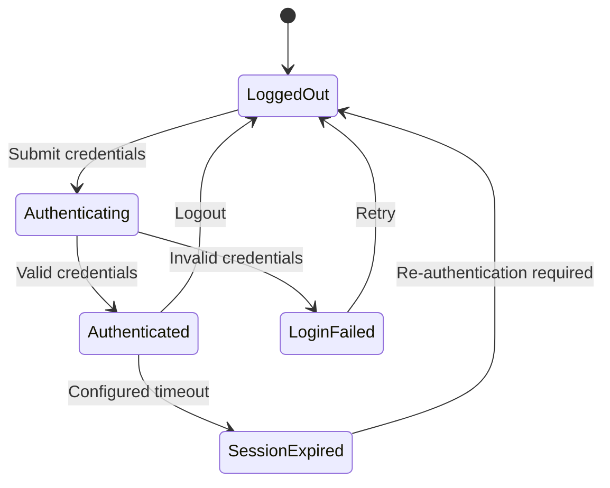
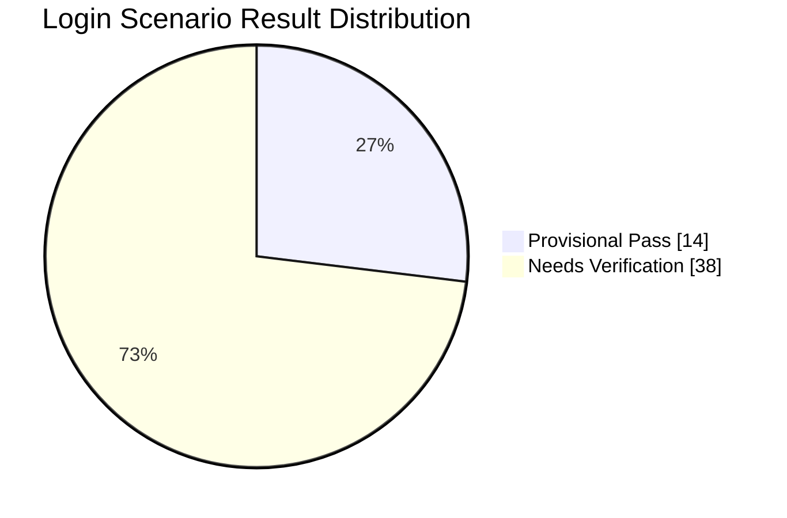

# Login Page Manual Testing — Test Scenarios

## 1. Project Information

| Parameter | Details |
|---|---|
| Project Name | Login Page Manual Testing |
| Application | Sample Web Application Login Page |
| Project Type | QA Portfolio Project |
| Testing Type | Manual Testing |
| Test Approach | Black-box Testing |
| Test Level | System Testing |
| Total Test Scenarios | 52 |
| Total Test Cases | 55 |
| Total Test Data Records | 45 |
| Scenario Design Status | Completed |
| Execution Verification | Pending |
| Author | Gade Ameesha |

---

## 2. Objective

The objective of this document is to identify and
document functional and non-functional testing scenarios
for validating a web application login page.

The project focuses on:

- Authentication functionality
- Mandatory field validation
- Positive and negative workflows
- Input validation
- Boundary Value Analysis
- Equivalence Partitioning
- Decision Table Testing
- State Transition Testing
- Session management
- Security-related behavior
- Usability and accessibility
- Browser and device compatibility
- Basic performance observations
- Retesting and regression testing

---

## 3. Functional and Negative Testing Scenarios

| Scenario ID | Test Scenario | Testing Type | Priority | Test Case ID |
|---|---|---|---|---|
| TS001 | Verify login using valid credentials | Positive Testing | High | TC001 |
| TS002 | Verify login using an invalid username | Negative Testing | High | TC002 |
| TS003 | Verify login using an incorrect password | Negative Testing | High | TC003 |
| TS004 | Verify login when both credentials are invalid | Negative Testing | High | TC004 |
| TS005 | Verify login with both fields empty | Validation Testing | High | TC010 |
| TS006 | Verify login with username empty | Validation Testing | High | TC011 |
| TS007 | Verify login with password empty | Validation Testing | High | TC012 |
| TS008 | Verify username whitespace handling | Error Guessing | Medium | TC013, TC015 |
| TS009 | Verify username case-sensitivity rules | Functional Testing | Medium | TC005 |
| TS010 | Verify password case sensitivity | Functional Testing | High | TC006 |
| TS011 | Verify Login button functionality | Functional Testing | High | TC007 |
| TS012 | Verify Enter key submission | Functional / Usability | Medium | TC008 |

---

## 4. Password and Security Control Scenarios

| Scenario ID | Test Scenario | Testing Type | Priority | Test Case ID |
|---|---|---|---|---|
| TS013 | Verify password masking | Security / UI | High | TC038 |
| TS014 | Verify show/hide password control, if supported | Functional / Security | Medium | TC039 |

---

## 5. Boundary Value Analysis Scenarios

| Scenario ID | Test Scenario | Testing Technique | Priority | Test Case ID |
|---|---|---|---|---|
| TS015 | Verify username minimum length | BVA | Medium | TC021 |
| TS016 | Verify username maximum length | BVA | Medium | TC023 |
| TS017 | Verify input just below minimum length | BVA | Medium | TC020 |
| TS018 | Verify input just above maximum length | BVA | Medium | TC024 |

### Assumed Username Length Requirements

- Minimum Length: 8 characters
- Maximum Length: 20 characters

| Boundary | Input Length | Expected Length Validation |
|---|---:|---|
| Minimum - 1 | 7 | Invalid |
| Minimum | 8 | Valid |
| Minimum + 1 | 9 | Valid |
| Maximum - 1 | 19 | Valid |
| Maximum | 20 | Valid |
| Maximum + 1 | 21 | Invalid |

These boundaries are hypothetical practice requirements.
Actual application requirements must be confirmed.

Passing length validation does not guarantee successful
authentication.

---

## 6. Equivalence Partitioning and Decision Table Scenarios

| Scenario ID | Test Scenario | Testing Technique | Priority | Test Case ID |
|---|---|---|---|---|
| TS019 | Verify valid and invalid input partitions | Equivalence Partitioning | High | TC016–TC019 |
| TS020 | Verify combinations of valid and invalid credentials | Decision Table Testing | High | TC026 |

### Equivalence Partitioning

| Input Partition | Example | Expected Behavior |
|---|---|---|
| Valid Username | Registered test username | Accepted with correct password |
| Invalid Username | Unregistered username | Authentication rejected |
| Valid Password | Correct account password | Accepted with valid username |
| Invalid Password | Incorrect password | Authentication rejected |
| Empty Username | Blank input | Validation displayed |
| Empty Password | Blank input | Validation displayed |
| Whitespace Username | Spaces only | Invalid account not authenticated |

### Decision Table

| Rule | Username | Password | Expected Action |
|---|---|---|---|
| R1 | Valid | Valid | Login successful |
| R2 | Valid | Invalid | Login rejected |
| R3 | Invalid | Valid | Login rejected |
| R4 | Invalid | Invalid | Login rejected |
| R5 | Empty | Valid | Username validation |
| R6 | Valid | Empty | Password validation |
| R7 | Empty | Empty | Required-field validation |

---

## 7. State Transition and Session Management Scenarios

| Scenario ID | Test Scenario | Testing Type | Priority | Test Case ID |
|---|---|---|---|---|
| TS021 | Verify successful login state transition | State Transition | High | TC027 |
| TS022 | Verify failed login state transition | State Transition | High | TC028 |
| TS023 | Verify account lockout rules, if supported | State Transition / Security | High | TC029 |
| TS024 | Verify session expiration, if supported | State Transition / Security | High | TC030 |
| TS025 | Verify logout and re-login behavior | Functional / Security | High | TC009 |
| TS026 | Verify protected page access without login | Security Testing | High | TC043 |
| TS027 | Verify browser Back behavior after logout | State Transition / Security | High | TC031 |

### Login State Transition Diagram

Session expiration and account lockout are
application-dependent features.

---

## 8. Error Guessing and Exploratory Testing Scenarios

| Scenario ID | Test Scenario | Testing Type | Priority | Test Case ID |
|---|---|---|---|---|
| TS028 | Verify extremely long input handling | Error Guessing | Medium | TC032 |
| TS029 | Verify special character handling | Error Guessing | Medium | TC033 |
| TS030 | Verify rapid repeated login submissions | Error Guessing | Medium | TC034 |

---

## 9. Security Testing Scenarios

| Scenario ID | Test Scenario | Testing Type | Priority | Test Case ID |
|---|---|---|---|---|
| TS031 | Verify SQL injection input handling | Security Testing | High | TC040 |
| TS032 | Verify script-like input handling | Security Testing | High | TC041 |
| TS033 | Verify password is not exposed in the URL | Security Testing | High | TC042 |
| TS034 | Verify error messages do not reveal sensitive details | Security Testing | High | TC044 |

### Security Testing Guidelines

- Perform security checks only in an authorized environment.
- Use dedicated test accounts.
- Do not expose confidential credentials.
- Verify authentication and authorization behavior.
- Document reproducible security-related observations.
- Do not claim that the application is vulnerability-free
  based only on these manual checks.

---

## 10. Usability and Accessibility Scenarios

| Scenario ID | Test Scenario | Testing Type | Priority | Test Case ID |
|---|---|---|---|---|
| TS035 | Verify keyboard navigation and focus order | Accessibility Testing | Medium | TC045 |
| TS036 | Verify labels and validation messages | Usability / Accessibility | Medium | TC046 |
| TS037 | Verify login page layout and readability | UI / Usability | Medium | TC048 |

---

## 11. Compatibility and Responsive Testing Scenarios

| Scenario ID | Test Scenario | Testing Type | Priority | Test Case ID |
|---|---|---|---|---|
| TS038 | Verify login across supported browsers | Compatibility Testing | Medium | TC049 |
| TS039 | Verify responsive layout at supported screen sizes | Responsive UI Testing | Medium | TC050 |
| TS040 | Verify login behavior on supported mobile devices | Compatibility Testing | Medium | TC051 |

### Browser Coverage

| Browser | Planned Coverage | Verification Status |
|---|---|---|
| Google Chrome | Valid and invalid login | Pending |
| Mozilla Firefox | Valid and invalid login | Pending |
| Microsoft Edge | Valid and invalid login | Pending |

### Responsive Testing Coverage

| Device Category | Example Viewport |
|---|---:|
| Small Mobile | 320 px |
| Mobile | 375 px |
| Tablet | 768 px |
| Desktop | 1024 px |
| Large Desktop | 1920 px |

---

## 12. Basic Performance Testing Scenarios

| Scenario ID | Test Scenario | Testing Type | Priority | Test Case ID |
|---|---|---|---|---|
| TS041 | Observe login response time | Basic Performance Testing | Medium | TC052 |
| TS042 | Observe login page load time | Basic Performance Testing | Low | TC053 |

Performance results must be compared against documented
acceptance criteria.

Manual response-time observations do not replace
load, stress, or scalability testing.

---

## 13. Retesting and Regression Testing Scenarios

| Scenario ID | Test Scenario | Testing Type | Priority | Test Case ID |
|---|---|---|---|---|
| TS043 | Retest a fixed login defect | Retesting | High | TC054 |
| TS044 | Run regression tests after a relevant change | Regression Testing | High | TC055 |

Retesting requires a confirmed defect and an available fix.

Regression testing requires a relevant application change
and an established baseline.

---

## 14. Additional Test Scenarios

The following scenarios improve traceability and cover
test cases that were not explicitly represented in the
original scenario document.

| Scenario ID | Test Scenario | Testing Type | Priority | Test Case ID |
|---|---|---|---|---|
| TS045 | Verify password containing only spaces | Negative Testing | Medium | TC014 |
| TS046 | Verify username length immediately above minimum | Boundary Value Analysis | Low | TC022 |
| TS047 | Verify empty and single-character username | Boundary Value Analysis | Medium | TC025 |
| TS048 | Verify page refresh during login | Exploratory Testing | Medium | TC035 |
| TS049 | Verify network interruption during login | Exploratory Testing | Medium | TC036 |
| TS050 | Verify error message consistency | Exploratory / Security | Medium | TC037 |
| TS051 | Verify password copy/paste and autofill behavior | Usability / Security | Low | TC047 |
| TS052 | Verify username and password leading/trailing whitespace behavior | Error Guessing | Medium | TC015 |

---

## 15. Scenario Execution Status

### Status Definitions

| Status | Description |
|---|---|
| Pass | Observed behavior matches the expected result |
| Fail | Observed behavior differs from the expected result |
| Blocked | Execution cannot proceed due to a dependency |
| Not Executed | Scenario has not been executed |
| Provisional Pass | Expected standard behavior; actual evidence is unavailable |
| Needs Verification | Application-specific behavior or execution evidence requires confirmation |
| Not Applicable | Feature is not supported or does not apply |

---

## 16. Scenario-wise Provisional Result Summary

| Scenario ID | Expected / Reconstructed Behavior | Status |
|---|---|---|
| TS001 | Valid credentials allow authentication | Provisional Pass |
| TS002 | Invalid username is rejected | Provisional Pass |
| TS003 | Incorrect password is rejected | Provisional Pass |
| TS004 | Invalid credentials are rejected | Provisional Pass |
| TS005 | Required-field validation is displayed | Provisional Pass |
| TS006 | Username validation is displayed | Provisional Pass |
| TS007 | Password validation is displayed | Provisional Pass |
| TS008 | Username whitespace handling requires confirmation | Needs Verification |
| TS009 | Username case-sensitivity rules require confirmation | Needs Verification |
| TS010 | Incorrect case-modified password is rejected | Provisional Pass |
| TS011 | Login submission behavior requires verification | Needs Verification |
| TS012 | Enter key submission requires verification | Needs Verification |
| TS013 | Password is expected to remain masked | Provisional Pass |
| TS014 | Password visibility control requires confirmation | Needs Verification |
| TS015 | Minimum username length requires confirmation | Needs Verification |
| TS016 | Maximum username length requires confirmation | Needs Verification |
| TS017 | Below-minimum input validation requires verification | Needs Verification |
| TS018 | Above-maximum input validation requires verification | Needs Verification |
| TS019 | Valid and invalid input partitions behave as expected | Provisional Pass |
| TS020 | Credential combinations produce expected outcomes | Provisional Pass |
| TS021 | Valid login changes authentication state | Provisional Pass |
| TS022 | Invalid login maintains unauthenticated state | Provisional Pass |
| TS023 | Account lockout rules require confirmation | Needs Verification |
| TS024 | Session timeout behavior requires confirmation | Needs Verification |
| TS025 | Logout and re-login behavior require verification | Needs Verification |
| TS026 | Protected page authorization requires verification | Needs Verification |
| TS027 | Browser Back behavior requires verification | Needs Verification |
| TS028 | Extremely long input handling requires verification | Needs Verification |
| TS029 | Special character validation requires confirmation | Needs Verification |
| TS030 | Repeated submission handling requires verification | Needs Verification |
| TS031 | SQL injection input handling requires authorized testing | Needs Verification |
| TS032 | Script-like input handling requires authorized testing | Needs Verification |
| TS033 | Password exposure in URLs requires inspection | Needs Verification |
| TS034 | Sensitive information disclosure requires inspection | Needs Verification |
| TS035 | Keyboard navigation requires verification | Needs Verification |
| TS036 | Labels and validation messages require inspection | Needs Verification |
| TS037 | Page layout and readability require inspection | Needs Verification |
| TS038 | Cross-browser results require verification | Needs Verification |
| TS039 | Responsive layout requires verification | Needs Verification |
| TS040 | Mobile device behavior requires verification | Needs Verification |
| TS041 | Login response-time measurements are unavailable | Needs Verification |
| TS042 | Page-load measurements are unavailable | Needs Verification |
| TS043 | A confirmed defect fix is required | Needs Verification |
| TS044 | Application change and regression baseline are required | Needs Verification |
| TS045 | Incorrect whitespace-only password is rejected | Provisional Pass |
| TS046 | Above-minimum username length requires verification | Needs Verification |
| TS047 | Empty and single-character input handling requires verification | Needs Verification |
| TS048 | Authentication state after refresh requires verification | Needs Verification |
| TS049 | Network interruption and recovery require verification | Needs Verification |
| TS050 | Error message consistency requires verification | Needs Verification |
| TS051 | Password copy/paste and autofill require verification | Needs Verification |
| TS052 | Leading and trailing whitespace rules require confirmation | Needs Verification |

These classifications are based on expected standard
login behavior and previously prepared provisional
test case results.

They do not represent independently verified execution.

---

## 17. Scenario Execution Dashboard

| Metric | Count |
|---|---:|
| Original Test Scenarios | 44 |
| Additional Test Scenarios | 8 |
| Total Test Scenarios | 52 |
| Provisional Passed Scenarios | 14 |
| Scenarios Requiring Verification | 38 |
| Confirmed Passed Scenarios | Not Established |
| Confirmed Failed Scenarios | Not Established |
| Confirmed Defects | Not Established |

### Provisional Scenario Distribution

### Scenario Metrics

- Provisional Pass Percentage: 26.92%
- Verification Pending Percentage: 73.08%

These percentages describe provisional classifications,
not a verified application pass rate.

---

## 18. Related Test Case Execution Summary

| Metric | Count |
|---|---:|
| Total Test Cases | 55 |
| Provisional Passed Test Cases | 17 |
| Test Cases Requiring Verification | 38 |
| Provisional Pass Percentage | 30.91% |
| Verification Pending Percentage | 69.09% |
| Total Test Data Records | 45 |

Scenario-level and test-case-level counts differ
because one scenario may cover multiple test cases,
and one test case may support multiple scenarios.

---

## 19. Requirement Traceability Matrix

| Scenario ID | Test Case ID | Test Data ID |
|---|---|---|
| TS001 | TC001 | TD001 |
| TS002 | TC002 | TD002 |
| TS003 | TC003 | TD003 |
| TS004 | TC004 | TD004 |
| TS005 | TC010 | TD005 |
| TS006 | TC011 | TD006 |
| TS007 | TC012 | TD007 |
| TS008 | TC013, TC015 | TD008, TD028 |
| TS009 | TC005 | TD009 |
| TS010 | TC006 | TD010 |
| TS011 | TC007 | TD001 |
| TS012 | TC008 | TD001, TD022 |
| TS013 | TC038 | TD023 |
| TS014 | TC039 | TD038 |
| TS015 | TC021 | TD014 |
| TS016 | TC023 | TD016 |
| TS017 | TC020 | TD015 |
| TS018 | TC024 | TD017 |
| TS019 | TC016–TC019 | TD001, TD002, TD003, TD012 |
| TS020 | TC026 | TD001–TD007 |
| TS021 | TC027 | TD001 |
| TS022 | TC028 | TD003 |
| TS023 | TC029 | TD021 |
| TS024 | TC030 | TD031 |
| TS025 | TC009 | TD030 |
| TS026 | TC043 | TD033 |
| TS027 | TC031 | TD032 |
| TS028 | TC032 | TD013 |
| TS029 | TC033 | TD011 |
| TS030 | TC034 | TD034 |
| TS031 | TC040 | TD018 |
| TS032 | TC041 | TD019 |
| TS033 | TC042 | TD020 |
| TS034 | TC044 | TD037 |
| TS035 | TC045 | TD022 |
| TS036 | TC046 | TD024 |
| TS037 | TC048 | TD040 |
| TS038 | TC049 | TD041 |
| TS039 | TC050 | TD042 |
| TS040 | TC051 | TD042 |
| TS041 | TC052 | TD043 |
| TS042 | TC053 | TD043 |
| TS043 | TC054 | TD044 |
| TS044 | TC055 | TD045 |
| TS045 | TC014 | TD029 |
| TS046 | TC022 | TD025 |
| TS047 | TC025 | TD027 |
| TS048 | TC035 | TD035 |
| TS049 | TC036 | TD036 |
| TS050 | TC037 | TD002, TD003 |
| TS051 | TC047 | TD039 |
| TS052 | TC015 | TD008 |

### Traceability Coverage

| Metric | Coverage |
|---|---|
| Test Scenarios Mapped | 52/52 |
| Test Cases Mapped | 55/55 |
| Test Case Mapping Coverage | 100% |
| Test Data Records | 45 |

TD026 provides supplementary maximum-minus-one boundary
coverage and requires a dedicated test case if included
in formal execution.

Mapping coverage does not represent verified execution
or complete application requirement coverage.

---

## 20. Testing Techniques Coverage

| Testing Technique | Scenario Coverage |
|---|---|
| Positive Testing | TS001, TS010, TS021 |
| Negative Testing | TS002–TS008, TS022, TS045 |
| Equivalence Partitioning | TS019 |
| Boundary Value Analysis | TS015–TS018, TS046, TS047 |
| Decision Table Testing | TS020 |
| State Transition Testing | TS021–TS025, TS027 |
| Error Guessing | TS008, TS028–TS030, TS052 |
| Exploratory Testing | TS048–TS050 |
| Security Testing | TS013, TS014, TS023–TS027, TS031–TS034 |
| Usability Testing | TS012, TS035–TS037, TS051 |
| Compatibility Testing | TS038–TS040 |
| Basic Performance Testing | TS041, TS042 |
| Retesting | TS043 |
| Regression Testing | TS044 |

---

## 21. Entry Criteria

Testing can begin when:

- The application test environment is available.
- Login page requirements are documented.
- Test scenarios and test cases are prepared.
- Suitable test data is available.
- Dedicated test accounts are provided.
- Supported browsers and devices are identified.
- Security testing authorization is available where required.
- Performance acceptance criteria are defined.

### Entry Criteria Status

Test design is completed. Application-specific
execution prerequisites require confirmation.

---

## 22. Exit Criteria

Testing can be considered complete when:

- Planned test scenarios have been executed.
- Actual results have been recorded.
- Failed and blocked scenarios have been investigated.
- Unsupported features have been marked Not Applicable.
- Reproducible defects have been documented with evidence.
- Required retesting has been completed.
- Regression testing has been completed where applicable.
- The final execution report has been updated.
- Remaining risks and limitations have been documented.

### Exit Criteria Status

Pending verified execution results and supporting evidence.

---

## 23. Risks and Limitations

| Risk | Impact | Mitigation |
|---|---|---|
| Application requirements unavailable | Expected behavior may be uncertain | Confirm documented requirements |
| Test account unavailable | Positive login cannot be verified | Create a dedicated test account |
| Missing execution evidence | Results cannot be confirmed | Execute tests and capture evidence |
| Hypothetical username boundaries | BVA results may be inaccurate | Confirm actual input limits |
| Unsupported lockout or timeout | Related scenarios may not apply | Confirm feature availability |
| Browser-specific behavior | Results may differ | Execute cross-browser tests |
| Security testing restrictions | Security coverage may be limited | Obtain explicit authorization |
| Missing performance targets | Response times cannot be evaluated | Define acceptance criteria |
| Missing defect fix or change baseline | Retesting and regression cannot proceed | Document fixes and changes |

---

## 24. Project Deliverables

| Deliverable | Status |
|---|---|
| Test Scenario Documentation | Completed - 52 Scenarios |
| Detailed Test Cases | Completed - 55 Test Cases |
| Test Data Documentation | Completed - 45 Records |
| Requirement Traceability Matrix | Completed |
| Boundary Value Analysis | Designed |
| Equivalence Partitioning | Designed |
| Decision Table | Designed |
| State Transition Diagram | Prepared |
| Test Execution Report | Provisional |
| Defect Report | Pending confirmed defects |
| Execution Evidence | Pending |
| Final Test Closure | Pending |

---

## 25. Project Completion Checklist

- [x] Identify login functionality
- [x] Prepare functional test scenarios
- [x] Prepare negative test scenarios
- [x] Prepare input validation scenarios
- [x] Design boundary value scenarios
- [x] Identify equivalence partitions
- [x] Prepare decision table
- [x] Prepare state transition scenarios
- [x] Identify security testing scenarios
- [x] Prepare usability and accessibility scenarios
- [x] Prepare compatibility scenarios
- [x] Prepare performance observation scenarios
- [x] Map scenarios to test cases
- [x] Map scenarios to test data
- [x] Prepare provisional result summary
- [ ] Confirm application requirements
- [ ] Verify actual execution results
- [ ] Capture supporting evidence
- [ ] Confirm reproducible defects
- [ ] Complete applicable retesting and regression
- [ ] Complete final test closure

---

## 26. Final Project Status

- **Test Scenario Design:** Completed
- **Total Test Scenarios:** 52
- **Total Test Cases:** 55
- **Total Test Data Records:** 45
- **Test Case Mapping Coverage:** 100%
- **Provisional Passed Scenarios:** 14
- **Scenarios Requiring Verification:** 38
- **Confirmed Defects:** Not Established
- **Execution Verification:** Pending
- **Final Test Closure:** Pending

---

## 27. Conclusion

The Login Page Manual Testing project demonstrates
a structured approach to validating authentication,
input validation, session management, security,
usability, compatibility, and performance behavior.

A total of 52 test scenarios, 55 detailed test cases,
and 45 test data records have been documented.

The project includes major black-box testing techniques,
requirement traceability, scenario classification,
and professional QA documentation.

The provisional scenario results must be verified
against an actual application before establishing
confirmed pass/fail metrics and defect counts.

---

## Author

**Gade Ameesha**

Software Developer | QA Engineer

- GitHub: https://github.com/GadeAmeesha
- LinkedIn: https://www.linkedin.com/in/gade-ameesha/
